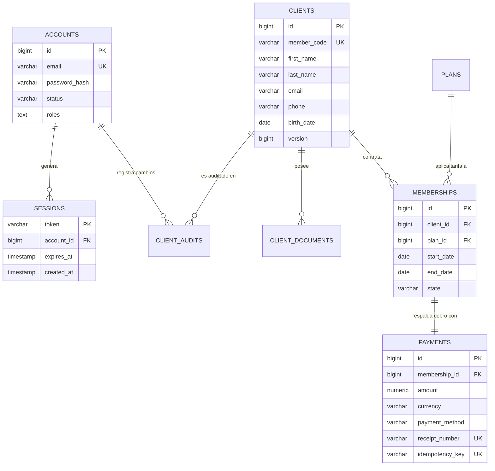
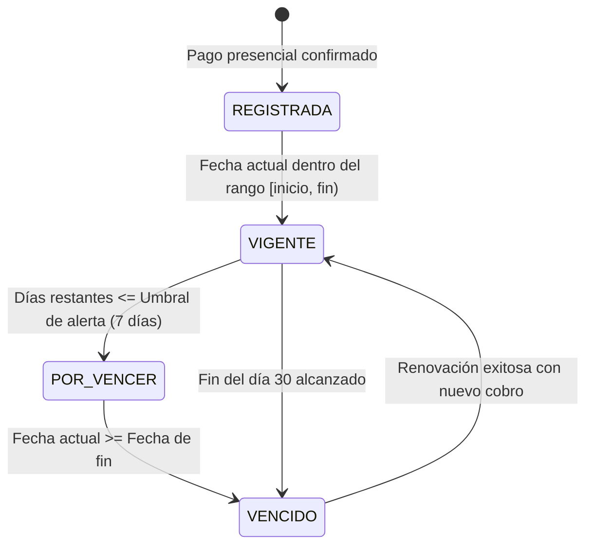
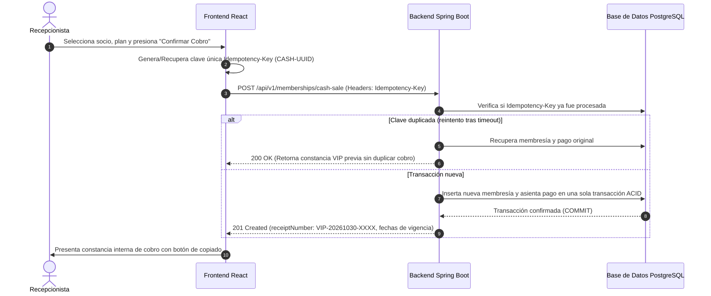
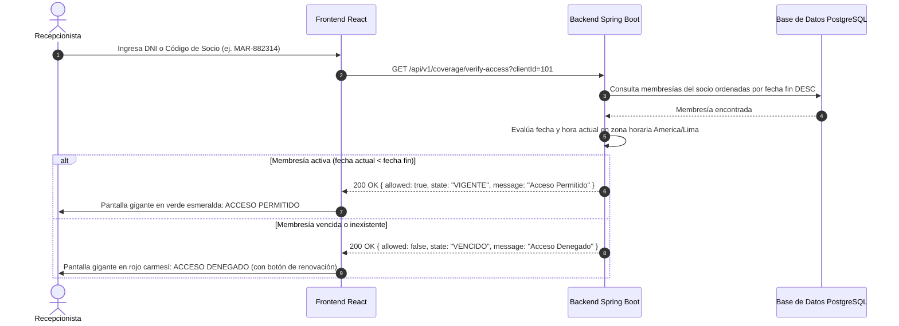

# Arquitectura, Diagramas C4 y Modelos de Ingeniería — GYM VIP

> **Ubicación Canónica:** `gymvip-frontend/documentos/ARQUITECTURA_Y_MODELOS.md`  
> **Fuente PlantUML C4:** [`c4.uml`](./c4.uml)  
> **Fecha de Actualización:** 30 de Octubre de 2026  
> **Referencias Históricas:** [`historico/ARCHITECTURE.md`](./historico/ARCHITECTURE.md), [`historico/C4_BASE_ACTUAL.md`](./historico/C4_BASE_ACTUAL.md), [`historico/ERD_BASE_ACTUAL.md`](./historico/ERD_BASE_ACTUAL.md), [`historico/MODELOS_BASE_ACTUAL.md`](./historico/MODELOS_BASE_ACTUAL.md)

---

## 1. Arquitectura del Sistema

El sistema implementa una **arquitectura por capas que aplica principios de Clean Architecture**:
1. **Capa de Controladores (Controller):** Endpoints REST con validación de entrada Jakarta Bean Validation (`@Valid`) y mapeo a DTOs.
2. **Capa de Servicios (Service):** Lógica pura de negocio, reglas de cálculo de vigencias, transacciones atómicas con `@Transactional` e invariantes de aislamiento.
3. **Capa de Repositorios (Repository):** Abstracciones de persistencia Spring Data JPA con tipos fuertemente tipados.
4. **Capa de Entidades (Entity):** Modelos relacionales con control de versiones optimista (`@Version`) e inmutabilidad en auditoría.
5. **Capa de Seguridad (Security):** Filtro de autenticación por token `TokenAuthenticationFilter` y protección RBAC mediante `@PreAuthorize`.

---

## 2. Modelado de Arquitectura C4 (PlantUML)

El archivo fuente oficial [`c4.uml`](./c4.uml) contiene la especificación C4 completa del sistema dividida en cuatro niveles:
- **Nivel 1 — Contexto de Sistema (C1):** Interacción entre los actores (Administrador, Recepcionista y Socio de gimnasio) con el Sistema GYM VIP.
- **Nivel 2 — Contenedores (C2):** Desacoplamiento entre la Single Page Application (React / Vite), la API RESTful (Spring Boot 3.4.3) y la Base de Datos Relacional (PostgreSQL 17).
- **Nivel 3 — Componentes (C3):** Estructura interna de Spring Boot detallando los componentes `AuthController`, `ClientController`, `MembershipController`, `CoverageController`, `PlanController` y `AccountController`, conectados a sus respectivos servicios y repositorios.
- **Nivel 4 — Código y Dominio (C4):** Diagrama de clases de las entidades `Account`, `Session`, `Client`, `ClientDocument`, `ClientAudit`, `Plan`, `Membership` y `Payment`.

---

## 3. Modelo Entidad-Relación (ERD) y Migraciones Flyway

El esquema de base de datos se mantiene de forma inmutable mediante 5 migraciones Flyway (`db/migration/`):
- `V1__init_accounts_and_sessions.sql`: Tablas `accounts` (usuarios con BCrypt) y `sessions` (tokens UUID con expiración).
- `V2__init_clients_and_documents.sql`: Tablas `clients` (con código de socio) y `client_documents` (DNI/Pasaporte).
- `V3__init_plans.sql`: Tabla `plans` con nombres, precios en PEN, días de vigencia y número de versión.
- `V4__init_memberships_and_payments.sql`: Tablas `memberships` (fechas de inicio y fin) y `payments` (constancia `VIP-...`, monto y clave de idempotencia).
- `V5__init_client_audits.sql`: Tabla `client_audits` para registro histórico inmutable de modificaciones sobre socios.

---

## 4. Los Seis Modelos de Ingeniería

### Modelo 1: Negocio
- **Objetivo:** Optimizar las operaciones de atención, cobro presencial y control de acceso del gimnasio VIP Center Fit S.A.C., reduciendo tiempos de espera en recepción y garantizando que solo socios con membresía activa ingresen a las instalaciones.
- **Actores:** Administrador de Sede, Recepcionista de Mostrador y Socio Cliente.

### Modelo 2: Requisitos
- **Historias de Usuario:** HU-01 (Registro), HU-02 (Edición y Auditoría), HU-04 (Personal), HU-06 (Planes), HU-07 (Membresías), HU-08 (Cobro Presencial), HU-09 (Vigencias), HU-10 (Renovación), HU-11 (Vencimientos) y HU-12 (Verificación de Acceso).
- **Restricciones de Calidad:** Disponibilidad local, tiempos de respuesta menores a 500ms en mostrador, protección contra ataques de fuerza bruta y cero tolerancia a cobros duplicados.

### Modelo 3: Análisis
- Asignación de responsabilidades mediante patrones GRASP y separación de preocupaciones. El cálculo de vigencias se centraliza en el dominio del backend bajo zona horaria `America/Lima`.

### Modelo 4: Diseño
- Arquitectura cliente-servidor desacoplada. Frontend con React 18, Vite y Vanilla CSS Dark & Gold. Backend con Spring Boot 3.4.3 y PostgreSQL 17 con Flyway.

### Modelo 5: Pruebas
- Casos de prueba automatizados unitarios y de integración para evaluar idempotencia, concurrencia optimista HTTP 409, reglas de expiración, cálculo de fechas e invariantes de seguridad.

### Modelo 6: Implementación
- Artefactos compilables: JAR ejecutable (`gymvip-backend-1.0.0-SNAPSHOT.jar`) y distribución estática empaquetada (`dist/`).

---

## 5. Diagramas de Comportamiento Dinámico

### 5.1 Diagrama de Estados de una Membresía

### 5.2 Diagrama de Secuencia: Cobro Presencial Atómico e Idempotente

### 5.3 Diagrama de Secuencia: Verificación Manual en Mostrador

