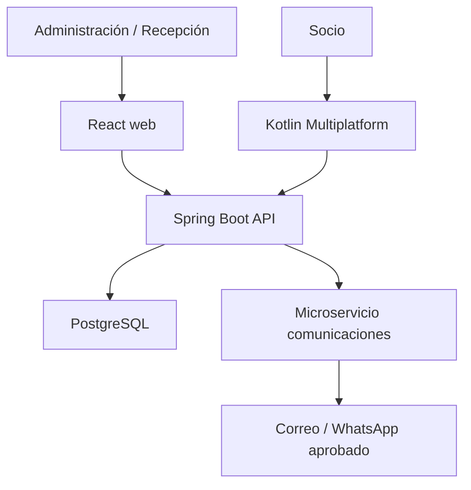

# ARCHITECTURE — GYM VIP E01/E02

**Estado:** diseño inicial sujeto a inspección de repos locales y a reglas del negocio. El Charter fija React, Spring Boot, Kotlin Multiplatform, Clean Architecture/capas y **un** microservicio de comunicaciones. Java/Kotlin en backend se decide después de inspeccionar código y experiencia del equipo; propuesta: Java 21 o versión LTS efectivamente soportada por su Spring Boot actual, sin migración gratuita de lenguaje. PostgreSQL es propuesta de persistencia.

## Contexto y contenedores

Backend único de negocio para web/móvil. `Comms` recibe eventos o solicitudes internas de envío y devuelve estado/ID, sin decidir elegibilidad de membresía ni permisos. En el primer incremento, un adaptador de correo/WhatsApp de prueba registra entregas ficticias sin datos personales reales. No duplicar base de socios ni escribir directamente desde frontend a DB. Contratos API versionados y DTOs; reglas de fecha/rol validadas en dominio/API, jamás únicamente en React o Kotlin.

## Módulos y entidades

| Módulo | Responsabilidad | Datos iniciales |
|---|---|---|
| Identidad | Cuenta, credenciales, sesión, verificación de contacto, recuperación | `Account`, `Session`, `ContactChallenge` |
| Clientes | Ficha y representante, documentos, preferencias y evidencia | `Client`, `Document`, `RepresentativeLink`, `ConsentRecord`, `Contact` |
| Autorización/auditoría | Roles, permisos, excepciones, eventos de cambio | `Role`, `Permission`, `ApprovalRequest`, `AuditEvent` |
| Catálogo | Planes editables y sus versiones | `Plan`, `PlanVersion` |
| Membresías | Períodos, snapshot contractual y vigencia | `Membership`, `MembershipTermsSnapshot` |
| Cobros registrados | Recibido presencial, referencia, reversión | `PaymentRecord`, `PaymentCorrection` |
| Comunicaciones | Correo de activación, WhatsApp de prueba/producción, entregas | `MessageRequest`, `DeliveryStatus` |

Cardinalidades: `Client 1─0..1 Account`; `Client 1─0..n Membership`; `Plan 1─n PlanVersion`; `Membership 1─1 PlanVersion snapshot`; `Membership 1─n PaymentRecord` para historia extensible aunque MVP exija pago completo; `Client 0..n ConsentRecord`; `Client (menor) 0..1 RepresentativeLink → persona representante` por validar. La identidad del socio y del representante se mantiene separada. Documento normalizado: unicidad por `(country, type, normalized_number)` con índice único transaccional; verificar posibles casos migrados antes de aplicar la restricción.

## Contratos de ejemplo para primera demo

| Endpoint propuesto | Permiso | Respuesta clave |
|---|---|---|
| `POST /api/v1/auth/sessions` y `DELETE /api/v1/auth/sessions/current` | Cuenta propia | Sesión con expiración, cookie segura web |
| `POST /api/v1/clients` | Recepción/Admin | `clientId`; 409 por documento repetido; no filtrar ficha existente |
| `GET /api/v1/clients?query=&page=` | Recepción/Admin | Lista paginada y estado de contactos |
| `PATCH /api/v1/clients/{id}/contacts` | Permiso de edición | Nueva verificación pendiente + audit event |
| `POST /api/v1/plans`, `GET /api/v1/plans` | Admin crea; personal consulta | Plan con versión y precio/condiciones |
| `POST /api/v1/memberships` | Recepción/Admin | Membresía y cobro presencial creados en una transacción; clave idempotente |
| `GET /api/v1/clients/{id}/membership-status` | Recepción/Admin; socio propio por ruta propia | Estado y fechas del servidor |

Errores con código estable, mensaje seguro y `correlationId`; 401 no autenticado, 403 sin permiso, 409 documento/operación duplicada. `POST` de activación, recuperación y envíos se rate limita; respuestas genéricas evitan revelar si existe una cuenta.

## Seguridad y evidencia

- Web: sesión servidor o tokens rotables con cookie `HttpOnly`, `Secure`, `SameSite` y protección CSRF cuando corresponda. Móvil: tokens cortos y renovación con revocación, secretos en Keychain/Keystore. Configuración real de expiración según rol. HTTPS siempre.
- Personal: contraseña con hash de algoritmo actual recomendado (Argon2id si infraestructura lo soporta; alternativa aprobada por el framework), MFA para superadmin. No fecha de nacimiento, documento ni PIN débil como clave. Enlace/OTP de recuperación de un solo uso, aleatorio, con expiración y límite de intentos; no exigir JWT para restablecimiento.
- Auditoría: actor, acción, objeto, instante UTC, zona para pantalla, antes/después minimizados, motivo, IP/dispositivo cuando disponibles y correlation ID. Separar auditoría de mensajes de error; control de acceso a logs, retención por acordar y copias protegidas. Anulación = nueva operación, sin borrar evento original.
- Consentimiento: `policy_type`, `version`, `choice`, `subject_id`, `acting_representative_id` opcional, `channel`, `timestamp_utc`, `evidence_ref`; registro de aceptación y revocación. No usar una sola casilla para términos, privacidad y marketing.
- Cuenta de emergencia: si cliente la autoriza, credencial personal/segura mantenida fuera del código, MFA o control equivalente, alarma y revisión posterior; recuperación institucional con verificación reforzada. Prohibido dejar un superadmin secundario hardcodeado.

## Integridad, fallos y copias

`assignMembership` valida cliente/plan/rol, adquiere protección contra carreras, crea snapshot de condiciones y asiento de pago dentro de **una transacción**, y devuelve mismo resultado ante el mismo `Idempotency-Key`. Reversiones producen asientos compensatorios; no se actualiza un pago antiguo en silencio. Reglas de calendario implementadas una sola vez con `LocalDate` y reloj/zona inyectados; fechas de 29–31 y tolerancia esperan ejemplos firmados antes de cerrar HU-09/HU-10.

Para interrupción de internet en MVP: recepción usa procedimiento manual numerado con mínima información, custodia y carga posterior por un usuario autorizado; el sistema marca fuente y concilia duplicados. Un verdadero modo offline con escritura y sincronización bidireccional implica manejo de conflictos, cifrado local, revocación y pruebas especiales: decisión de alcance posterior. El fallback físico de torniquetes corresponde a infraestructura del cliente, fuera de E01/E02.

Backups diarios cifrados de base de datos con copia fuera de la máquina y restauración ensayada; determinar retención, RPO/RTO y responsable. Una instantánea del servidor no reemplaza un backup probado de PostgreSQL. Secretos por entorno y `.env.example` sin valores; CI corre pruebas y migraciones en entorno de ensayo.

## Repos y pasos de arranque

1. Inspeccionar ramas, remotos, build y cambios no guardados de `GIMVIP Backend`, `GIMVIP Frontend`, `GIMVIP Mobile`, `GIMVIP Comunicaciones`; conservar tecnologías existentes.
2. Backend: arquitectura por capas generales bajo paquete raíz `com.gymvip`: `config`, `controller`, `dto/request`, `dto/response`, `entity`, `enums`, `exception`, `mapper`, `repository`, `security`, `service`, `service/impl` y `util`. Reemplaza la estructura modular previa por contextos sin alterar contratos ni tablas.
3. Definir migración inicial, DTO/contrato OpenAPI y datos semilla ficticios; persistencia en PostgreSQL con Flyway; pruebas de ensayo en memoria.
4. Primera porción vertical: login personal y permiso mínimo → crear/listar plan real en BD → formulario React → prueba integrada; alta/búsqueda de cliente en paralelo tras acordar forma de documento/consentimiento adulto.
5. Móvil inicia con navegación y prototipo; Comms con interfaz y stub. Integrarlos cuando HU-05/HU-28 o E03 entren al Sprint. Documentar diagramas C4, ERD y secuencia al lado de contratos reales.

Ninguna carpeta, endpoint o tecnología aquí confirma que exista ya en los repos locales del equipo.
