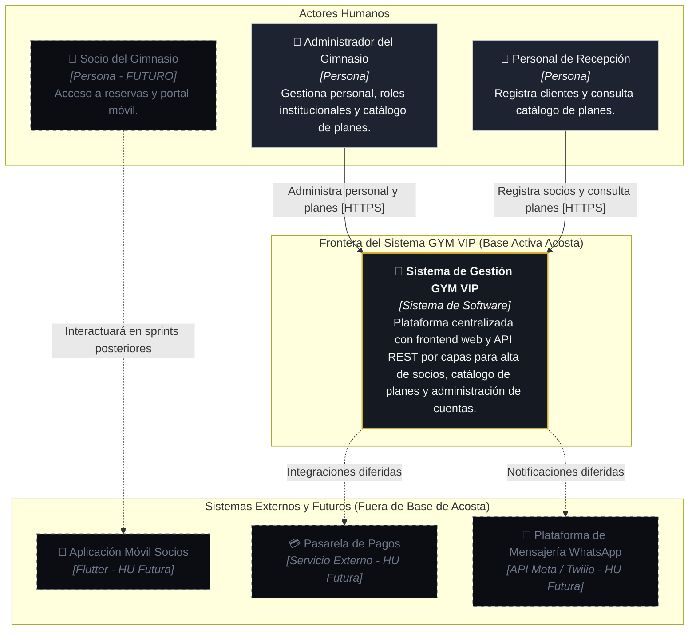
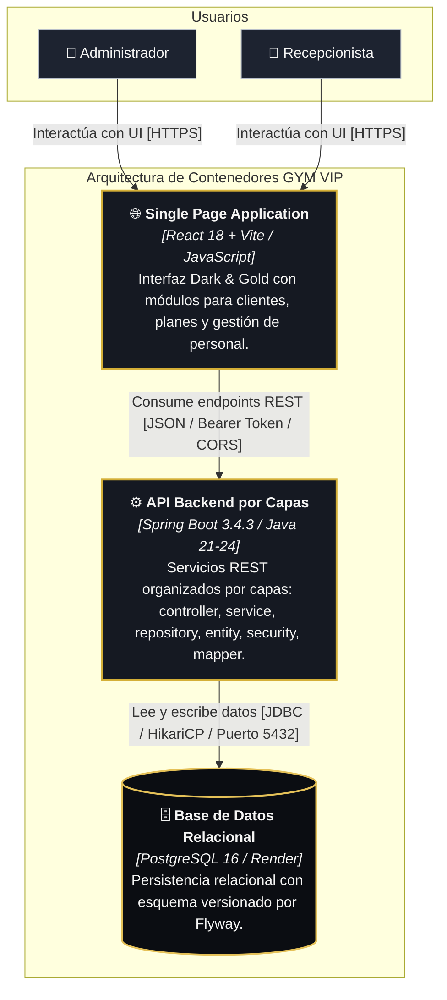
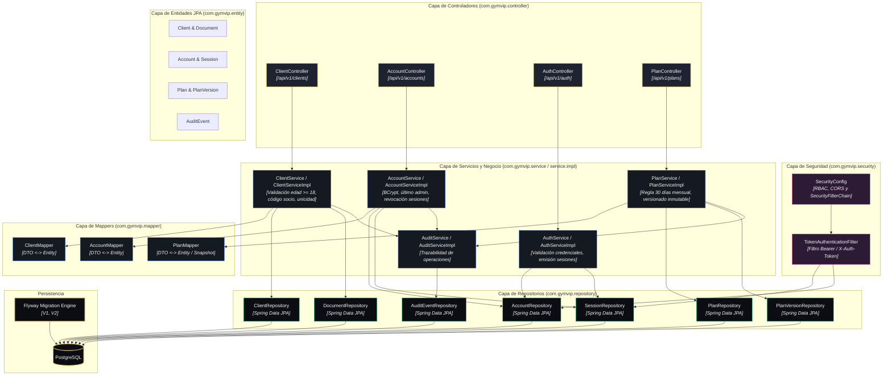
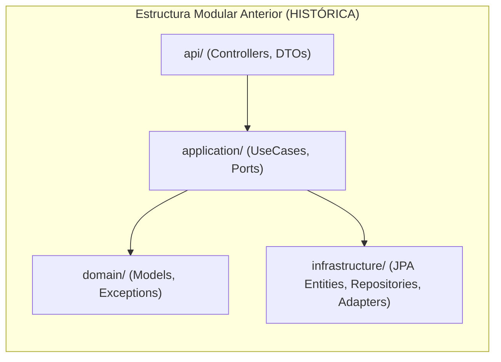

# C4_BASE_ACTUAL.md — Modelo Arquitectónico C4 (Arquitectura por Capas)

> **Proyecto:** GYM VIP (VIP CENTER FIT)  
> **Alcance:** Base Funcional Sprint 1 — Incremento Acosta (HU-01, HU-04, HU-06)  
> **Patrón Arquitectónico Backend:** Arquitectura por Capas Generales (`controller`, `service`, `repository`, `entity`, `dto`, `mapper`, `security`, `config`, `enums`, `exception`, `util`).  
> **Notación:** Modelo C4 implementado con diagramas Mermaid estructurados.

---

## 1. Nivel 1: Diagrama de Contexto del Sistema (C1)

Muestra los usuarios institucionales activos, la frontera del sistema actual implementado y las relaciones con actores/sistemas futuros del ecosistema GYM VIP.

---

## 2. Nivel 2: Diagrama de Contenedores (C2)

Describe los tres contenedores de software que conforman la base técnica activa y sus protocolos de comunicación.

---

## 3. Nivel 3: Diagrama de Componentes Backend (C3 — Arquitectura por Capas)

Estructura interna de `gymvip-backend` organizada por capas horizontales de responsabilidad:

---

## 4. Diagrama Histórico de Referencia (Clean Architecture previa)

> [!NOTE]
> Este diagrama refleja la estructura modular previa (`clients`, `identity`, `plans`, `audit`, `shared`) conservado con fines de trazabilidad histórica:

