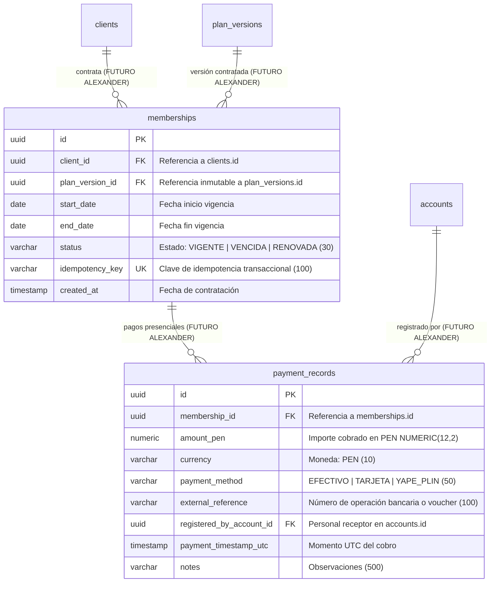

# ERD_BASE_ACTUAL.md — Modelo Entidad-Relación Físico y Delimitación de Alcance

> **Proyecto:** GYM VIP (VIP CENTER FIT)  
> **Alcance:** Base Funcional Sprint 1 — Incremento Acosta (HU-01, HU-04, HU-06, Seguridad y Auditoría)  
> **Motor de Persistencia Principal:** PostgreSQL (Local y Producción Render) / H2 en memoria exclusivo para suite de tests  
> **Manejador de Migraciones:** Flyway (`db/migration/V1__init_schema.sql`, `db/migration/V2__add_member_code_to_clients.sql`)

---

## 1. Modelo Entidad-Relación de Tablas Activas (Base Acosta)

Refleja exactamente las tablas y columnas físicas creadas por las migraciones Flyway V1 y V2 y mapeadas a entidades JPA en `com.gymvip.entity`.

```mermaid
erDiagram
    accounts ||--o{ account_roles : "roles asignados"
    accounts ||--o{ sessions : "sesiones activas"
    clients ||--|{ documents : "documentos de identidad"
    clients ||--o{ consent_records : "registro de avisos legales"
    plans ||--|{ plan_versions : "versiones tarifarias inmutables"

    accounts {
        uuid id PK
        varchar email UK "Correo institucional único (150)"
        varchar password_hash "Hash seguro BCrypt (255)"
        varchar status "Estado: ACTIVO | INACTIVO (30)"
        boolean mfa_enabled "Soporte MFA (por defecto FALSE)"
        timestamp created_at "Fecha y hora de creación"
        timestamp updated_at "Última modificación"
    }

    account_roles {
        uuid account_id PK, FK "Referencia a accounts.id"
        varchar role_id PK "Identificador del rol: ADMIN | RECEPCION (50)"
    }

    sessions {
        varchar token PK "Token alfanumérico seguro único (128)"
        uuid account_id FK "Referencia a accounts.id"
        timestamp expires_at "Expiración de la sesión (24h)"
        timestamp created_at "Fecha de inicio"
        varchar user_agent "Agente de usuario del cliente HTTP (255)"
        varchar ip_address "Dirección IP de origen (50)"
    }

    clients {
        uuid id PK
        varchar member_code UK "Código de socio único legible ej. MAR-8Q2L7K (30)"
        varchar first_name "Nombres del socio (100)"
        varchar last_name "Apellidos del socio (100)"
        date birth_date "Fecha de nacimiento (validación >= 18 años)"
        varchar phone "Teléfono de contacto opcional (50)"
        boolean phone_verified "Estado de verificación del teléfono"
        varchar email "Correo de contacto opcional (150)"
        boolean email_verified "Estado de verificación del correo"
        varchar status "Estado: ACTIVO | INACTIVO (30)"
        uuid account_id FK "Cuenta opcional asociada para portal futuro"
        timestamp created_at "Fecha de registro"
        timestamp updated_at "Última actualización"
    }

    documents {
        uuid id PK
        uuid client_id FK "Referencia a clients.id (ON DELETE CASCADE)"
        varchar country_code "Código de país ISO ej. PE (10)"
        varchar document_type "Tipo de documento: DNI | CARNET_EXTRANJERIA | PASAPORTE (30)"
        varchar document_number "Número de documento de identidad (50)"
        boolean is_primary "Indica si es el documento principal"
        timestamp created_at "Fecha de registro"
    }

    consent_records {
        uuid id PK
        uuid client_id FK "Referencia a clients.id (ON DELETE CASCADE)"
        varchar policy_type "Tipo de política: PRIVACIDAD | TERMINOS (50)"
        varchar policy_version "Versión de la política (20)"
        boolean choice "Aceptación expresa"
        varchar channel "Canal de registro: PRESENCIAL_RECEPCION (50)"
        varchar ip_address "IP de registro (50)"
        timestamp timestamp_utc "Momento UTC del consentimiento"
    }

    plans {
        uuid id PK
        varchar name UK "Nombre normalizado único del plan (120)"
        varchar description "Descripción del plan (500)"
        int duration_days "Duración en días (mensual = 30 días exactos)"
        numeric price_pen "Precio en Soles NUMERIC(12,2) mayor a 0"
        varchar benefits "Beneficios incluidos (1000)"
        varchar status "Estado: ACTIVO | INACTIVO (30)"
        int version "Versión tarifaria actual para concurrencia optimista"
        timestamp created_at "Fecha de creación"
        timestamp updated_at "Última modificación"
    }

    plan_versions {
        uuid id PK
        uuid plan_id FK "Referencia a plans.id (ON DELETE CASCADE)"
        int version_number "Número secuencial de versión"
        varchar name "Denominación histórica del plan (120)"
        int duration_days "Duración en días congelada"
        numeric price_pen "Precio histórico congelado NUMERIC(12,2)"
        varchar benefits "Beneficios históricos (1000)"
        timestamp effective_from "Fecha de vigencia de la versión"
    }

    audit_events {
        uuid id PK
        varchar actor_email "Correo del actor que ejecutó la acción (150)"
        varchar action "Acción ejecutada: REGISTER_CLIENT, CREATE_PLAN, etc. (100)"
        varchar entity_name "Entidad afectada: Client, Plan, Account (100)"
        varchar entity_id "ID de la entidad (100)"
        varchar details "Detalle descriptivo de la operación (2000)"
        timestamp timestamp_utc "Momento UTC exacto de la operación"
    }
```

---

## 2. Restricciones e Índices Físicos de Unicidad

| Tabla | Nombre del Índice / Restricción | Columnas | Propósito / HU |
|---|---|---|---|
| `documents` | `uk_document_country_type_num` | `(country_code, document_type, document_number)` | Unicidad documental compuesta por país (HU-01). |
| `clients` | `uk_clients_member_code` | `member_code` | Unicidad del código alfanumérico legible de socio (HU-01). |
| `plans` | `plans_name_key` | `name` | Unicidad de denominación de planes de membresía (HU-06). |
| `plan_versions` | `uk_plan_versions_plan_version` | `(plan_id, version_number)` | Inmutabilidad de versiones históricas tarifarias (HU-06). |
| `accounts` | `accounts_email_key` | `email` | Unicidad del correo institucional de personal (HU-04). |
| `sessions` | `PRIMARY KEY` | `token` | Búsqueda O(1) de sesión en filtro de seguridad RBAC. |

---

## 3. Tablas Reservadas Legacy (Fuera de Base Activa Acosta)

Estas tablas físicas se preservan en las migraciones de Flyway (`V1__init_schema.sql`) para que los integrantes responsables de la Parte 2 (Alexander: HU-07, HU-08, HU-10) y Parte 3 (Jorge: HU-02, HU-09, HU-11, HU-12) extiendan la base sin rehacer el esquema:

> [!NOTE]
> Las tablas `memberships` y `payment_records` no poseen código Java activo ni endpoints en el incremento de Acosta. Se documentan aquí como contrato físico base para la extensión de Alexander y Jorge.
