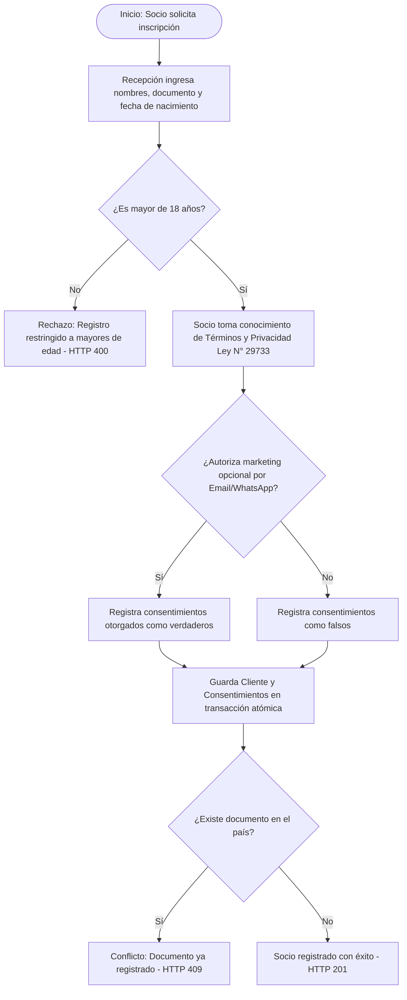
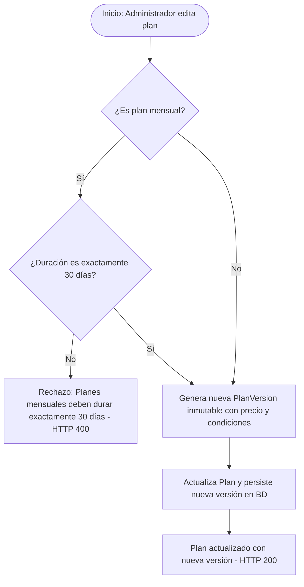
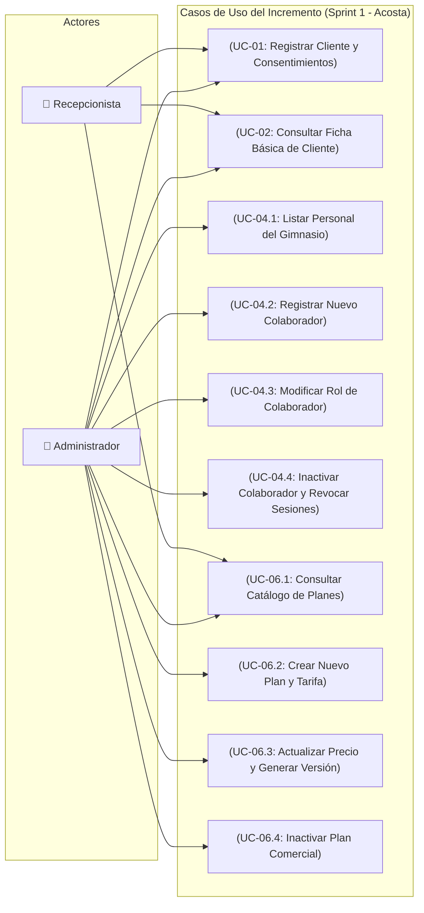
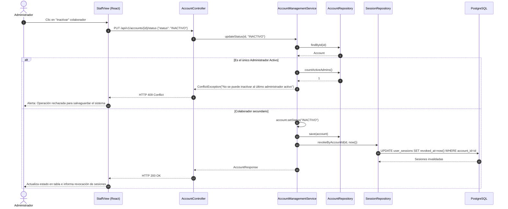
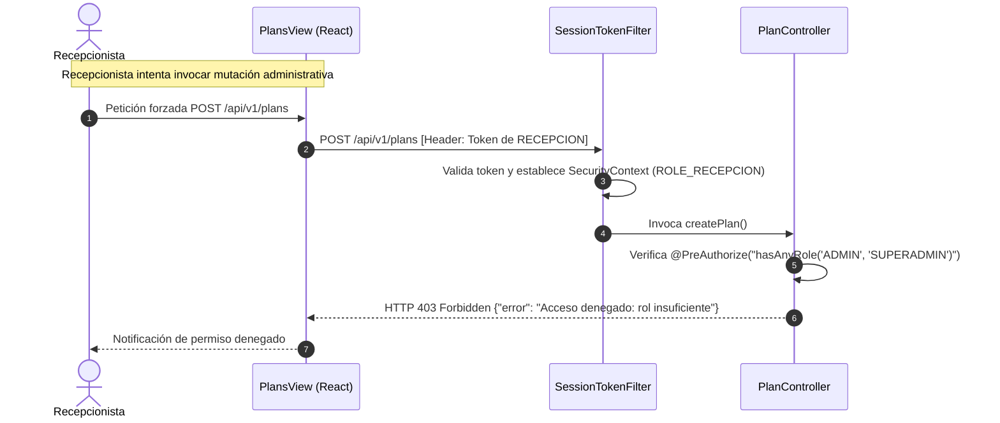
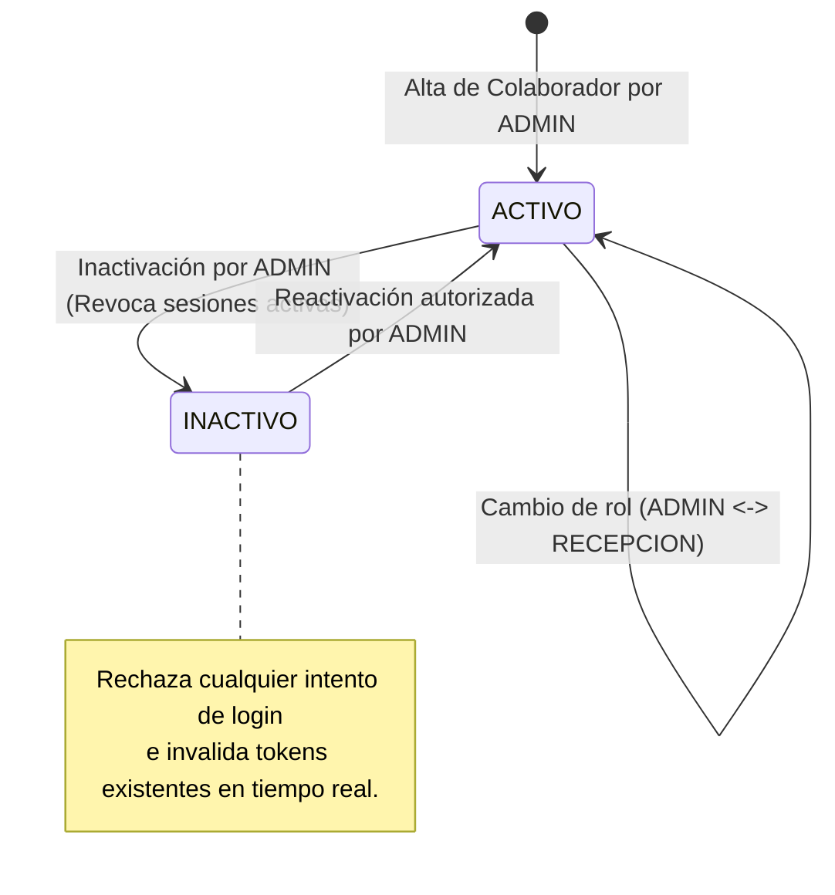
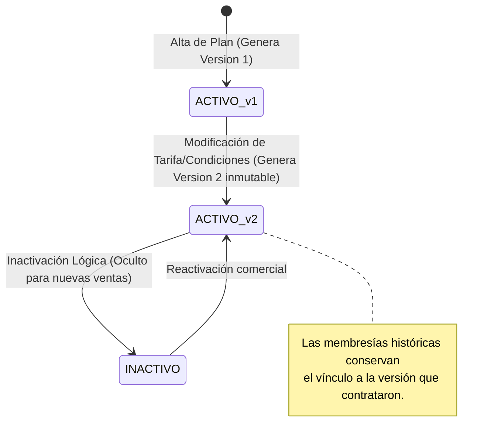

# MODELOS_BASE_ACTUAL.md — Modelos de Software (Base Activa)

> **Proyecto:** GYM VIP (VIP CENTER FIT)  
> **Alcance:** Base Funcional Sprint 1 — Incremento Acosta (HU-01, HU-04, HU-06)  
> **Nota Metodológica:** Alexander mantiene la responsabilidad general del modelado UML del equipo. Este documento contiene los modelos representativos de la base implementada y probada por Acosta, utilizando sintaxis Mermaid (`flowchart`, `sequenceDiagram`, `stateDiagram-v2`).

---

## 1. Modelo de Negocio (Flujos Operativos)

### 1.1 Flujo de Registro de Clientes y Consentimientos (HU-01)


### 1.2 Flujo de Modificación y Versionado de Planes (HU-06)


---

## 2. Modelo de Requerimientos (Casos de Uso Aproximados)

*Nota:* Dado que Mermaid no ofrece una sintaxis formal nativa para diagramas de casos de uso UML (`usecase`), se utiliza `flowchart` estructurado como aproximación funcional con estereotipos.



---

## 3. Diagramas de Secuencia (Interacciones Críticas)

### 3.1 Registrar Cliente Exitoso vs Duplicado Compuesto (HU-01)
```mermaid
sequenceDiagram
    autonumber
    actor Rec as Recepcionista
    participant UI as ClientsView (React)
    participant API as ClientController (Spring)
    participant Svc as ClientService
    participant Repo as ClientRepository
    participant DB as PostgreSQL / H2

    Rec->>UI: Ingresa datos (DNI 12345678, PER, mayor de edad) y consentimientos
    UI->>API: POST /api/v1/clients (Payload JSON)
    API->>Svc: registerClient(cmd)
    Svc->>Svc: Validar edad >= 18
    Svc->>Repo: existsByCountryCodeAndDocumentTypeAndDocumentNumber("PER", "DNI", "12345678")
    Repo->>DB: SELECT COUNT(*) WHERE country_code='PER' AND doc_type='DNI' AND doc_num='12345678'
    DB-->>Repo: 0 (No existe)
    Svc->>Repo: save(Client + List<ClientConsent>)
    Repo->>DB: INSERT INTO clients ... ; INSERT INTO client_consents ...
    DB-->>Repo: Confirmado (UUID generado)
    Svc-->>API: ClientResponse
    API-->>UI: HTTP 201 Created
    UI-->>Rec: Muestra confirmación y actualiza tabla

    Note over Rec,DB: Escenario Alternativo: Documento Duplicado Concurrente
    Rec->>UI: Intenta registrar mismo DNI 12345678
    UI->>API: POST /api/v1/clients
    API->>Svc: registerClient(cmd)
    Svc->>Repo: save(Client)
    Repo->>DB: INSERT INTO clients ...
    DB-->>Repo: Error Violación Constraint UK_CLIENT_DOCUMENT
    Repo-->>API: DataIntegrityViolationException
    API-->>UI: HTTP 409 Conflict {"message": "Ya existe un cliente con ese documento"}
    UI-->>Rec: Alerta de conflicto preservando datos en el formulario
```

### 3.2 Inactivar Colaborador con Revocación de Sesiones y Protección Último Admin (HU-04)


### 3.3 Control de Permisos: Recepción intenta crear un Plan (Rechazo 403 Forbidden)


---

## 4. Máquinas de Estado

### 4.1 Estados de Cuenta Institucional (`AccountStatus`)


### 4.2 Estados y Ciclo de Vida del Plan Comercial (`PlanStatus` y `PlanVersion`)


---

## 5. Trazabilidad Completa: HU → Caso → Componente → Endpoint → Tabla → Prueba

| HU | Caso de Uso | Componentes Principales | Endpoint HTTP | Tablas de Persistencia | Suite de Prueba Verificada |
| :--- | :--- | :--- | :--- | :--- | :--- |
| **HU-01** | UC-01 Registro Socio Adulto | `ClientController`<br>`ClientService` / `ClientServiceImpl`<br>`ClientsView.jsx` | `POST /api/v1/clients` | `clients`<br>`documents`<br>`audit_events` | `ClientIntegrationTest` |
| **HU-01** | UC-02 Lectura y Ficha Básica | `ClientController`<br>`ClientService` / `ClientServiceImpl`<br>`ClientsView.jsx` | `GET /api/v1/clients`<br>`GET /api/v1/clients/{id}`<br>`GET /api/v1/clients/code/{code}` | `clients`<br>`documents` | `ClientIntegrationTest` |
| **HU-04** | UC-04.1 Listar Personal | `AccountController`<br>`AccountService` / `AccountServiceImpl`<br>`StaffView.jsx` | `GET /api/v1/accounts` | `accounts`<br>`account_roles` | `AccountManagementIntegrationTest` |
| **HU-04** | UC-04.2 Alta de Personal | `AccountController`<br>`AccountService` / `AccountServiceImpl`<br>`StaffView.jsx` | `POST /api/v1/accounts` | `accounts`<br>`account_roles`<br>`audit_events` | `AccountManagementIntegrationTest` |
| **HU-04** | UC-04.3 Modificar Rol | `AccountController`<br>`AccountService` / `AccountServiceImpl`<br>`StaffView.jsx` | `PATCH /api/v1/accounts/{id}/role` | `accounts`<br>`account_roles`<br>`audit_events` | `AccountManagementIntegrationTest` |
| **HU-04** | UC-04.4 Inactivar y Revocar | `AccountController`<br>`AccountService` / `AccountServiceImpl`<br>`StaffView.jsx` | `PATCH /api/v1/accounts/{id}/status`<br>`POST /api/v1/accounts/{id}/revoke-sessions` | `accounts`<br>`sessions`<br>`audit_events` | `AccountManagementIntegrationTest` |
| **HU-06** | UC-06.1 Consultar Planes | `PlanController`<br>`PlanService` / `PlanServiceImpl`<br>`PlansView.jsx` | `GET /api/v1/plans`<br>`GET /api/v1/plans/{id}` | `plans`<br>`plan_versions` | `PlanIntegrationTest` |
| **HU-06** | UC-06.2 Crear Plan y Tarifa | `PlanController`<br>`PlanService` / `PlanServiceImpl`<br>`PlansView.jsx` | `POST /api/v1/plans` | `plans`<br>`plan_versions`<br>`audit_events` | `PlanIntegrationTest` |
| **HU-06** | UC-06.3 Nueva Versión Plan | `PlanController`<br>`PlanService` / `PlanServiceImpl`<br>`PlansView.jsx` | `PUT /api/v1/plans/{id}` | `plans`<br>`plan_versions`<br>`audit_events` | `PlanIntegrationTest` |
| **HU-06** | UC-06.4 Inactivar Plan | `PlanController`<br>`PlanService` / `PlanServiceImpl`<br>`PlansView.jsx` | `PATCH /api/v1/plans/{id}/status` | `plans`<br>`audit_events` | `PlanIntegrationTest` |
