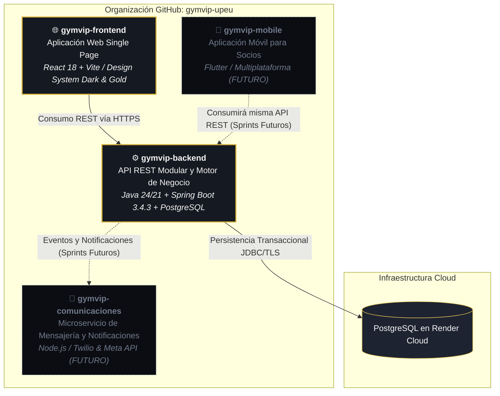

# Ecosistema Digital GYM VIP — Organización gymvip-upeu

> **Propuesta de Contenido Oficial para el Perfil Público de GitHub:**  
> **Destino Sugerido:** `gymvip-upeu/.github/profile/README.md`  
> *Nota:* Este documento contiene la plantilla y estructura preparada para documentar la organización sin publicar credenciales privadas ni datos personales.

---

## 1. Propósito Institucional

**GYM VIP** es una plataforma integral de gestión y control operacional diseñada para centros de acondicionamiento físico de alto rendimiento (**VIP CENTER FIT**). El sistema automatiza el ciclo de vida del socio, desde su registro legal conforme a la normativa de protección de datos (Ley N° 29733 de Perú) y la suscripción a planes de entrenamiento, hasta la administración del personal institucional, control de accesos e integración futura con plataformas móviles y pasarelas de pago.

---

## 2. Arquitectura del Ecosistema y Repositorios

El ecosistema se distribuye en repositorios modulares bajo la organización de GitHub [`gymvip-upeu`](https://github.com/gymvip-upeu):

### Enlaces a Repositorios
- **Backend API:** [github.com/gymvip-upeu/gymvip-backend](https://github.com/gymvip-upeu/gymvip-backend)
- **Frontend Web:** [github.com/gymvip-upeu/gymvip-frontend](https://github.com/gymvip-upeu/gymvip-frontend)
- **Mobile App:** [github.com/gymvip-upeu/gymvip-mobile](https://github.com/gymvip-upeu/gymvip-mobile) *(En roadmap)*
- **Comunicaciones:** [github.com/gymvip-upeu/gymvip-comunicaciones](https://github.com/gymvip-upeu/gymvip-comunicaciones) *(En roadmap)*

---

## 3. Metodología de Desarrollo y Trabajo en Equipo

El proyecto se gestiona mediante el marco de trabajo **Scrum**, distribuyendo el desarrollo entre tres ingenieros de software con responsabilidades modulares e independientes para garantizar entregas continuas sin bloqueos ni colisiones de código:

### Línea Base y Reparto del Sprint 1
1. **Base Común e Incremento 1 (Andre Acosta):**
   - Cimientos de Clean Architecture en Spring Boot y React 18.
   - Seguridad y sesiones basadas en tokens con RBAC (`ADMIN` y `RECEPCION`).
   - Esquema relacional con Flyway y compatibilidad con PostgreSQL en Render.
   - **HU-01:** Registrar Clientes adultos con consentimientos legales separados (Ley N° 29733) y unicidad compuesta.
   - **HU-04:** Roles y permisos con gestión de personal institucional y salvaguarda del último administrador activo.
   - **HU-06:** Configurar catálogo de planes con regla de 30 días exactos y versionado tarifario inmutable.
2. **Incremento 2 (Compañero 2):**
   - **HU-02:** Ficha médica y contactos extendidos del socio.
   - **HU-07 & HU-08:** Gestión de membresías activas, cálculo de vigencias y recaudación de pagos.
3. **Incremento 3 (Compañero 3):**
   - **HU-03 & HU-05:** Portal móvil y autoservicio para socios.
   - **HU-09 & HU-10:** Control de accesos por torniquete y auditoría de asistencia.

---

## 4. Estándares Técnicos y Calidad de Código

- **Arquitectura Limpia:** Separación estricta entre Dominio (reglas y entidades puras), Aplicación (casos de uso), Infraestructura (persistencia, transacciones, adaptadores) y API (controladores REST).
- **Diseño Visual:** Implementación del *Design System Dark & Gold Luxury* (fondos `#0B0D12`, superficies `#151922`, acentos dorados `#D4AF37`, tipografía de alto contraste y objetivos táctiles ≥ 44px).
- **Seguridad y Privacidad:**
  - Contraseñas almacenadas exclusivamente con hashing seguro BCrypt.
  - Control de accesos riguroso por endpoint HTTP con respuestas 401 Unauthorized y 403 Forbidden.
  - Variables de entorno estrictamente desacopladas mediante `.env` (ignorado en Git) y plantillas `.env.example`.
- **Estrategia de Ramas:**
  - Trabajo por ramas de funcionalidad (`feature/*` o ramas individuales como `base-acosta`).
  - Commits descriptivos bajo la convención *Conventional Commits* (`feat:`, `refactor:`, `chore:`, `docs:`).
  - Ningún secreto, credencial de base de datos o token personal se sube a los repositorios públicos.
